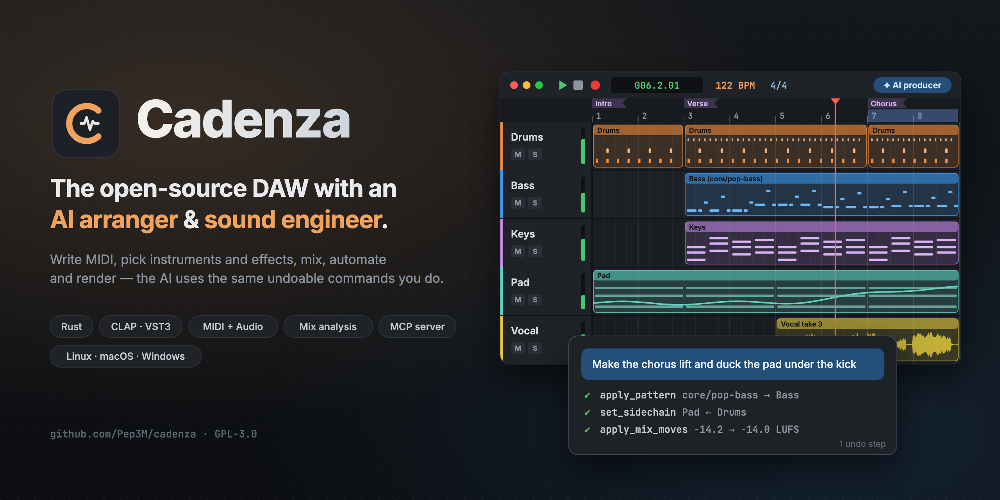

<p align="center">
  
</p>

<p align="center">
  <a href="https://github.com/Pep3M/cadenza/actions/workflows/ci.yml"></a>
  <a href="https://github.com/Pep3M/cadenza/releases/latest"></a>
  <a href="LICENSE"></a>
  
</p>

**Cadenza** is an open-source digital audio workstation and audio editor written in Rust.
Its differentiator is an AI that works as **arranger and sound engineer**: it writes MIDI,
chooses and inserts instruments and effects, mixes, automates and renders.

The AI is not a special path: it is just another client of the same command API the UI
uses. Every change it makes is a validated, undoable command, so you can review it, tweak
it or undo it like any edit of your own.

> **Status:** early development (0.x). Expect rough edges and project-format changes
> before 1.0. Bug reports and feedback are very welcome.

## Features

- **Arrange & edit** — instrument, audio, bus and folder tracks; piano roll with FL Studio-style
  tools; audio editor with fades, crossfades, takes and comping; automation lanes with
  touch/latch recording; tempo and time-signature changes.
- **Instruments & effects** — built-in synths, sampler and drum sampler, drum machine, EQ,
  compressor (with sidechain), reverb, delay and more; **CLAP and VST3** plugins, sandboxed
  in their own process so a crashing plugin never takes the session down.
- **Record** — audio and MIDI recording with latency compensation, loop takes, punch in/out,
  metronome and count-in.
- **Mix & export** — mixer with live meters, sends and routing; offline mix analysis
  (BS.1770 loudness, true peak, spectrum, masking) with suggested fixes; export to WAV, FLAC
  (and MP3) with stems, normalization and metadata.
- **AI producer** — chat with it inside the app, or from the command line: compose a song
  from a brief, request a change, or run a sound-engineer mix pass against a loudness target
  or a reference track. Works with OpenRouter or any OpenAI-compatible endpoint (including
  local models); you bring your own key.
- **Style library** — packs of styles, song forms, progressions, grooves and MIDI patterns
  that both you and the AI can search and drop into a song.
- **MCP server** — `cadenza mcp` exposes the whole command API to any MCP client.

## Install

### Linux and macOS

```sh
curl -fsSL https://github.com/Pep3M/cadenza/releases/latest/download/install.sh | sh
```

- **Linux** (x86_64): installs to `~/.local/opt/cadenza`, adds a desktop entry and the
  `cadenza` / `cadenza-app` commands in `~/.local/bin`. Audio needs ALSA (`libasound2`),
  present on most desktops.
- **macOS** (Apple Silicon and Intel, 11+): installs `Cadenza.app` to `/Applications`
  (or `~/Applications`) and the same commands in `~/.local/bin`.

Options: `--version v0.1.0`, `--bin-dir DIR`, `--app-dir DIR`, `--uninstall`. Pass them
after `sh -s --`, e.g. `curl -fsSL …/install.sh | sh -s -- --uninstall`.

### Arch Linux and Omarchy

From the AUR ([`cadenza-bin`](https://aur.archlinux.org/packages/cadenza-bin), the release
binaries): in Omarchy, **Install → AUR → cadenza-bin**, or from a terminal:

```sh
yay -S cadenza-bin
```

It installs to `/opt/cadenza` with `cadenza` / `cadenza-app` in `/usr/bin` and a desktop
entry. The PKGBUILD lives in `packaging/arch/` (`makepkg -si` there builds it locally).

### Windows

In PowerShell:

```powershell
irm https://github.com/Pep3M/cadenza/releases/latest/download/install.ps1 | iex
```

Installs to `%LOCALAPPDATA%\Programs\Cadenza`, adds a Start menu shortcut and puts the
folder on your user `PATH`. Set `$env:CADENZA_VERSION = "v0.1.0"` before running it for a
specific release, or `$env:CADENZA_UNINSTALL = "1"` to uninstall.

### Manual download

Every [release](https://github.com/Pep3M/cadenza/releases) ships a Linux `tar.gz` and
`AppImage`, a Windows `zip` and a macOS universal `dmg`, with a `SHA256SUMS` file to verify
them. The installers check those checksums for you.

> The binaries are not code-signed yet. On macOS, if you install from the `dmg` by hand,
> right-click the app and choose **Open** the first time. On Windows, SmartScreen may ask
> you to confirm ("More info" → "Run anyway").

## Quick start

```sh
cadenza-app                       # the desktop app (or: cadenza gui)
cadenza play song.cadenza.json    # play a project
cadenza render song.cadenza.json -o song.wav
cadenza --help                    # every command
```

### AI features

Set an [OpenRouter](https://openrouter.ai) key (or configure any OpenAI-compatible endpoint
in the app's AI settings):

```sh
export OPENROUTER_API_KEY=sk-or-...
cadenza compose "lo-fi ballad, 3 minutes, piano and strings" --out my-song --slug ballad
cadenza chat my-song/ballad.cadenza.json "add a bridge after the second chorus"
cadenza mix my-song/ballad.cadenza.json --target-lufs -14
```

In the app, press **F10** to open the AI producer; keys entered there are stored in your
OS keyring. Each request is capped by a configurable budget and lands as one undo step.

## Platform support

| | Linux | macOS | Windows |
|---|---|---|---|
| App, CLI, recording | ✅ | ✅ | ✅ |
| CLAP / VST3 plugins | ✅ sandboxed | ✅ sandboxed | ✅ in-process |
| Plugin editor windows | ✅ X11 / XWayland | planned | planned |

## Build from source

You need [Rust](https://rustup.rs) (the version in `RUST_TOOLCHAIN` of
[`ci.yml`](.github/workflows/ci.yml) is the one tested) and, on Linux, the ALSA headers:

```sh
sudo apt install pkg-config libasound2-dev   # Debian/Ubuntu
git clone https://github.com/Pep3M/cadenza.git
cd cadenza
cargo build --release -p cadenza-cli -p cadenza-app -p cadenza-plugin-host
./target/release/cadenza-app
```

Optional Cargo features (off by default): `mp3` (MP3 export, links LAME) and `stretch`
(time-stretch / pitch-shift, needs a C++ compiler and libclang), e.g.
`cargo build --release -p cadenza-cli --features mp3,stretch`.

The workspace is split into focused crates (`cadenza-model`, `cadenza-engine`,
`cadenza-dsp`, `cadenza-app`…); [`CLAUDE.md`](CLAUDE.md) documents the architecture and
the contract of each one.

## Contributing

Contributions are welcome — see [CONTRIBUTING.md](CONTRIBUTING.md). Please open an issue
before large changes so we can agree on the approach.

## License

Cadenza is free software: you can redistribute it and/or modify it under the terms of the
**GNU General Public License, version 3 or (at your option) any later version**. See
[LICENSE](LICENSE).

Third-party crates keep their own licenses (permissive or MPL-2.0, checked in CI with
`cargo deny`). Builds with the optional `mp3` feature link LAME (LGPL).
